# 实验报告

## 实验基本信息

| 项目 | 内容 |
|------|------|
| **实验名称** | Lab 2: 物理内存和页表 |
| **小组成员** | 2513333-张翌辰、2514195-郝春捷、2513191-陈大伟 |
| **完成日期** | 2026-10-24 |

### 小组分工

练习如何分工？

本报告按小组共同成果填写。现有实验记录未分别登记各成员独立负责的模块，因此保留三位成员信息，不虚构个人分工。

| 成员 | 负责的练习/模块 |
|------|----------------|
| 2513333-张翌辰 | 小组协作；个人模块归属未单独记录 |
| 2514195-郝春捷 | 小组协作；个人模块归属未单独记录 |
| 2513191-陈大伟 | 小组协作；个人模块归属未单独记录 |

实验报告如何分工？

实验报告根据小组提供的底稿、代码、实际调试记录和截图统一整理；没有单独记录到人的章节分工。完成日期保留底稿填写的2026-10-24，本文使用的实验记录已采集至2026-10-23。

---

## 一、实验目的

<!-- 说明本次实验的主要目标和预期成果 -->

本实验的主要目的是：

1. 理解物理内存范围获取、Page描述符布局与保留页管理，实现可用物理页初始化，区分虚拟地址、物理地址、页号和描述符指针。
2. 阅读First-Fit，实现Best-Fit和Buddy并设计验证，掌握连续页分配、切分、释放和合并，理解内外碎片及算法取舍。
3. 理解Sv39、页表项、satp和TLB，通过内核及QEMU源码两个层面的调试验证地址翻译；学习按四段式提示词描述需求并检验AI生成代码。

---

## 二、实验环境

你们使用的 AI 工具

本次可核实的AI协作工具为Codex桌面应用。原始材料未记录具体模型版本，也未分别记录三位成员使用工具的情况，以下不作推测。

| 成员 | AI 编程工具 | 底层模型 | 备注 |
|------|------------|---------|------|
| 2513333-张翌辰 | 个人工具使用未单独记录 | 未记录 | 小组本次协作使用Codex桌面应用 |
| 2514195-郝春捷 | Codex桌面应用（本次协作会话） | 具体版本未记录 | 配合VS Code、WSL终端完成实现和调试 |
| 2513191-陈大伟 | 个人工具使用未单独记录 | 未记录 | 不推测个人工具或模型 |

**说明：**
- **AI 编程工具**：指具体使用的终端工具、编辑器插件、桌面应用或浏览器界面
- **底层模型**：指该工具使用的大语言模型及版本

**实验运行环境：**

| 项目 | 本次使用情况 |
|---|---|
| 宿主环境 | Windows，VS Code 集成终端 |
| Linux 环境 | WSL2，Ubuntu 24.04 |
| 目标架构 | RISC-V 64 位，QEMU `virt`，单 hart 教学配置 |
| 交叉工具链 | `riscv64-unknown-elf-gcc` 13.2.0 及配套 binutils |
| 编译选项 | `-march=rv64imac_zicsr_zifencei -mabi=lp64`，保留调试信息 |
| 日常运行模拟器 | `qemu-system-riscv64` 8.2.2，默认固件输出 OpenSBI v1.3 |
| 内核调试器 | `gdb-multiarch` 15.1 |
| 模拟器源码调试 | Ubuntu 源码包 QEMU 8.2.2，独立构建并启用调试信息；宿主 GDB 调试 QEMU 进程 |
| 构建及辅助工具 | GNU Make、Python 3、Ninja、Meson |
| AI 编程工具 | Codex 桌面应用；具体底层模型版本未在实验材料中记录 |

默认物理内存为 128 MiB；补充测试使用 64、128、256 MiB。调试版 QEMU 位于 WSL 的 `~/oslab-qemu-debug/qemu-8.2.2+ds/build-lab2/`，与系统安装的模拟器分开，不替换日常运行环境。

---

## 三、实验整体逻辑分析

### 2.1 本章节的逻辑主线

本实验解决“内核如何知道哪些物理页可以用、如何分配和释放这些页，以及虚拟地址如何到达物理内存”的问题。分配器负责选择和管理物理页，页表负责描述地址映射，两者职责不同。

实际执行顺序如下：

```text
OpenSBI 进入 kern_entry
  → 保存 hart ID 和 DTB 物理地址
  → entry.S 配置启动页表、satp、栈并进入高地址内核
  → kern_init 清理 BSS，调用 dtb_init 解析设备树
  → pmm_init
      → init_pmm_manager：选择并初始化分配器
      → page_init：建立 Page 数组、确定可用完整页
          → init_memmap：把空闲区登记给当前分配器
      → check_alloc_page：调用当前分配器的 check
  → 输出启动页表地址，进入框架的无限循环
```

特别需要注意，`entry.S` 在进入 C 内核前已经开启 Sv39。`pmm_init()` 在现有映射下初始化物理页管理，不是第一次开启分页。

### 2.2 功能的逐步实现

首先需要有效的内存范围，才能确定描述符数组的长度；描述符数组本身占用内存，因此必须先保留其空间，再将剩余完整页交给分配器。之后通过统一的 `pmm_manager` 接口切换算法，最后通过测试和调试验证管理状态及地址映射。这样可以避免把内核或管理数据误分配出去，也便于在相同框架中比较不同算法。

---

## 四、实验内容与实现

<!-- 
说明：本部分按照 exercises 文档中的练习顺序组织
每个功能模块或者练习中可能包含多项任务，请根据实际情况调整
-->

### 功能模块：物理内存探测与Page描述符初始化

**负责人：** 小组共同成果；个人独立模块归属未单独记录。

#### 模块功能描述

**需要实现/修改的函数：**

```c
static void page_init(void);
```

**功能说明：**

主要补全的接口为：

```c
static void page_init(void);
```

关联接口为 `get_memory_base()`、`get_memory_size()`、`init_memmap()`、`pa2page()`、`page2pa()` 和 `PADDR()`。设备树解析沿用框架，不重新编写完整 DTB 解析器。

本模块的 spec 为：

- 从 DTB 获取 DRAM 起点和大小，设置 `va_pa_offset`、`npage` 和 `pages`。
- 区分内核虚拟地址与物理地址；`end` 是虚拟地址，不能直接当作物理边界。
- `npage` 为物理页号上界，描述符数量为 `npage - nbase`。
- `Page` 数组位于内核末尾之后，起点按页对齐。
- 初始将所有页描述符设为保留，再将剩余完整页交给当前分配器。
- 检查空范围、地址加法溢出、启动映射覆盖范围和描述符空间不足；没有完整空闲页时不调用 `init_memmap()`。

初始化使用：

```c
va_pa_offset = PHYSICAL_MEMORY_OFFSET;
npage = PPN(mem_end);
size_t count = npage - nbase;
uintptr_t pages_va = ROUNDUP((uintptr_t)end, PGSIZE);
uintptr_t pages_pa = PADDR(pages_va);
```

每个描述符均初始化引用计数、状态和链表节点，并设置保留标志。数组末尾转换为物理边界后向上对齐，DRAM 末尾向下对齐：

```c
free_begin = ROUNDUP(pages_pa + count * sizeof(struct Page), PGSIZE);
free_end = ROUNDDOWN(mem_end, PGSIZE);
if (free_begin < free_end) {
    init_memmap(pa2page(free_begin), (free_end - free_begin) / PGSIZE);
}
```

这样保留了内核、描述符和对齐空隙，也不会把尾部不足一页的空间交给分配器。当前实现明确限定 DRAM 起点为 `0x80000000`，总范围不超过启动映射覆盖的 1 GiB；不是对任意硬件、多段内存和所有保留区的通用管理器。

#### 最终提示词

完整提示词另汇总于同目录的[prompt.md](./prompt.md)，本栏目保留对应内容，便于独立阅读。

以下按课程要求填写四段式提示词。提示词为根据实际需求与最终实现整理的可复现版本，不冒充逐字保存的原始prompt。原始对话未逐轮记录精确迭代次数，迭代栏目按可核实的实现和接入验证阶段复盘。

````markdown
[PROMPT]
**任务**：在 kern/mm/pmm.c 中补全物理内存初始化函数 page_init()，完成物理页描述符布局、已用页面保留与空闲区注册。DTB 解析和地址转换接口沿用工程实现。
**操作要求**：必须在项目中修改实际文件，而不是只展示代码。保留 pmm_init 的调用关系和既有测试，只补全目标位置；禁止修改测试来取得通过。允许增加模块内部 static 辅助函数，不改变公开接口。
**输出要求**：依照以下 [RELY]、[GUARANTEE] 和 [SPECIFICATION] 实现，以工程真实定义为准；完成后给出修改位置、验证结果和边界说明，不引入无关功能。

[RELY]
相关文件：kern/mm/pmm.h、kern/mm/memlayout.h、kern/mm/mmu.h、kern/driver/dtb.h、libs/defs.h、libs/riscv.h 和 tools/kernel.ld。
相关宏：PGSIZE、PGSHIFT、DRAM_BASE、PHYSICAL_MEMORY_OFFSET、PPN、ROUNDUP、ROUNDDOWN、PADDR、SetPageReserved。本工程基本页为4096字节，启动映射覆盖从DRAM_BASE起的1 GiB。
真实数据结构：
```c
struct Page {
    int ref;
    uint64_t flags;
    unsigned int property;
    list_entry_t page_link;
};
```
已有全局变量：struct Page *pages；size_t npage；const size_t nbase；uint64_t va_pa_offset。nbase=DRAM_BASE/PGSIZE，描述符数组覆盖物理页号区间[nbase,npage)，第i个元素对应物理页号nbase+i。
可依赖的现有接口（不是本任务重新实现的交付项）：
```c
uint64_t get_memory_base(void);
uint64_t get_memory_size(void);
static void init_memmap(struct Page *base, size_t n);
static inline struct Page *pa2page(uintptr_t pa);
static inline void set_page_ref(struct Page *page, int val);
```
另可使用 list_init、panic、cprintf。链接符号end表示内核末尾的虚拟地址；PADDR将有效内核虚拟地址转换为物理地址，并依赖va_pa_offset已初始化。

[GUARANTEE]
必须在 kern/mm/pmm.c 实现：
```c
static void page_init(void);
```
保留已有DTB查询、地址转换和空闲区注册接口，不重复定义它们；允许新增仅本模块使用的static辅助函数、宏和变量。

[SPECIFICATION]
## page_init
**Pre-Condition**:
- 启动映射已建立，设备树解析已尝试完成；当前分配器已被选择并初始化，但尚未登记本次空闲区。
- 内核链接符号及页描述符类型有效；函数不接收参数。
**Post-Condition**:
- 对于受支持且有效的内存范围，地址偏移、可管理物理页号上界和描述符数组地址与工程约定一致。
- 所有可管理物理页均具有初始化后的描述符；内核、固件、描述符数组和必要对齐空间不会被注册为空闲页。
- 只有剩余完整页被登记给当前分配器；输出探测范围。
  **Case 1**: 当设备树范围有效、处于启动映射内且足够存放描述符时，建立按页对齐的数组，保留已占区域，并登记剩余非空完整页区间，返回后管理状态可供分配器使用。
  **Case 2**: 当范围无效、起点不受支持、地址相加溢出、超出启动映射或描述符无处存放时，报告错误并终止初始化，不继续向分配器登记该范围。
  **Case 3**: 当描述符可以建立但之后没有剩余完整页时，不调用空闲区注册接口，不将不完整尾页视为空闲页。
**Requirements**:
- 先建立地址转换所需状态，再转换内核地址；先保留元数据，再登记空闲页。
- 区分物理地址、虚拟地址、页号与描述符指针；不得把npage直接作为数组元素数量。
- 面向本实验单段DRAM和单核环境，不扩展成任意硬件内存管理器。
````

#### 实现迭代过程

本模块精确的提示词轮次未记录，以下保留模板栏目，分别说明功能补全和启动接入验证，不将两个阶段虚构为两次独立算法失败。

##### 第一次迭代

**遇到的问题：**

- 原框架缺少page_init实现，需要明确npage不是数组元素数，以及元数据自身不能进入空闲区。

**问题解决策略：**

- 在[RELY]补充真实Page字段、地址转换和nbase关系，在[SPECIFICATION]规定保留、对齐、异常范围与空闲区注册条件。

**最终结果：**

- ✅ 完成page_init，建立描述符并登记可用完整页。
- ✅ 默认128 MiB配置得到32768个描述符；后续GDB与评分验证通过。

**关键改进点总结（如有）：**

1. 将物理页号上界与描述符数量分开。
2. 先预留内核及数组，再注册空闲页。
3. 明确无完整剩余页时不调用注册接口。

##### 第二次迭代（如有）

**遇到的问题：**

- 接入验证发现原QEMU启动命令未正确传递内核入口，只有固件输出；切换分页后低地址PC还需要有效映射。

**问题解决策略：**

- 运行命令与评分脚本改用-kernel；启动页表增加低地址恒等映射；编译选项明确CSR及fence相关指令扩展。

**最终结果：**

- ✅ 内核进入高地址kern_init，初始化输出正常，Page Init评分通过。

**关键改进点总结（如有）：**

- 区分分配器代码与启动接入问题，用入口断点和实际输出定位原因。


---

### 练习：理解First-Fit连续物理内存分配算法

**负责人：** 小组共同成果；个人独立模块归属未单独记录。

| 函数 | 作用 |
|---|---|
| `default_init()` | 初始化空闲链表，令空闲页计数为零 |
| `default_init_memmap(base, n)` | 将给定范围转换为空闲块，登记首页及块长，按地址插入链表 |
| `default_alloc_pages(n)` | 找到第一个足够大的块，摘除并按需切分，减少空闲页计数 |
| `default_free_pages(base, n)` | 回收页并按地址插入，检查前后相邻空闲块并合并 |

`Page` 是页的管理信息，不是页内数据；连续空闲块只将首页挂入空闲链表，首页 `property` 表示块长。块中其他页仍有各自的描述符，但不需要全部挂链。

分配时，对按地址组织的链表执行首次适应查找。一旦找到 `property >= n` 的块便停止；若有剩余，剩余块首页为 `page+n`。释放时，先插入正确地址位置，再通过 `前块首页+前块长度==本块首页` 等条件判定物理相邻性。

本任务以阅读已有代码为主，未重写原有实现及测试。


**运行验证：** 使用`make clean`、`make PMM=first_fit qemu`，输出default_pmm_manager与自检成功，截图见第五部分。

**思考题：原有First-Fit算法是否有改进空间？**

有。当前分配和有序插入可能需要线性扫描，最坏时间与空闲块数相关。可以按大小分级、引入平衡树或建立地址与大小双索引，但需要维护一致性，增加实现复杂度。也可引入搜索位置缓存形成 Next-Fit，但这会改变策略，不能直接称为原始 First-Fit。当前已经执行相邻合并，改进时必须保持这一性质。

---

### 功能模块：Best-Fit连续物理内存分配

**负责人：** 小组共同成果；个人独立模块归属未单独记录。

#### 模块功能描述

**需要实现/修改的函数：**

```c
static void best_fit_init(void);
static void best_fit_init_memmap(struct Page *base, size_t n);
static struct Page *best_fit_alloc_pages(size_t n);
static void best_fit_free_pages(struct Page *base, size_t n);
static size_t best_fit_nr_free_pages(void);
static void init_pmm_manager(void); /* 修改管理器选择 */
```

**功能说明：**

实现 `best_fit_init()`、`best_fit_init_memmap()`、`best_fit_alloc_pages()`、`best_fit_free_pages()`、`best_fit_nr_free_pages()`，并定义 `best_fit_pmm_manager`。

约束为：选择满足请求的最小空闲块；支持切分及相邻合并；准确维护计数和首页状态；保留 `basic_check()`、`best_fit_check()`；在 `init_pmm_manager()` 中接入。默认构建选择 Best-Fit，也可通过编译参数切换另外两种算法。

与 First-Fit 的主要区别在候选更新条件：

```c
if (p->property >= n) {
    if (page == NULL || p->property < page->property) {
        page = p;
        if (p->property == n) break;
    }
}
```

First-Fit 选第一个可用块，Best-Fit 在候选中选最小者。例如按地址依次有互不相邻的 8、4、6 页空闲块，申请 3 页时，两者分别选择 8 页块和 4 页块。该例用于解释策略，不是本次截图中运行的额外测试。

切分和回收部分保留地址有序链表的不变量。合并时检查物理相邻，而不是仅检查链表相邻；合并后的块只有一个首页保留 `PG_property`。

#### 最终提示词

完整提示词另汇总于同目录的[prompt.md](./prompt.md)，本栏目保留对应内容，便于独立阅读。

以下按课程要求填写四段式提示词。提示词为根据实际需求与最终实现整理的可复现版本，不冒充逐字保存的原始prompt。原始对话未逐轮记录精确迭代次数，迭代栏目按可核实的实现和接入验证阶段复盘。

````markdown
[PROMPT]
**任务**：在 kern/mm/best_fit_pmm.c 补全连续页Best-Fit分配器并定义注册结构；在 kern/mm/pmm.c 的 init_pmm_manager 中接入默认Best-Fit，保留First-Fit和Buddy的编译选项。
**操作要求**：必须修改项目中的实际文件；保留框架现有 basic_check()、best_fit_check() 及其他测试，不删除既有逻辑，不通过更改测试掩盖问题。允许本模块static辅助函数、内部宏及静态状态。
**输出要求**：以以下上下文和行为规格为依据完成文件操作，报告实现位置及编译、启动和评分结果；不引入无关功能，不仅修改管理器名称。

[RELY]
相关文件：kern/mm/pmm.h、kern/mm/memlayout.h、kern/mm/default_pmm.c、kern/mm/best_fit_pmm.h 和 libs/list.h。
Page的真实字段为int ref、uint64_t flags、unsigned int property和list_entry_t page_link；每页一个描述符，连续描述符对应连续物理页。
```c
typedef struct {
    list_entry_t free_list;
    unsigned int nr_free;
} free_area_t;
struct pmm_manager {
    const char *name;
    void (*init)(void);
    void (*init_memmap)(struct Page *base, size_t n);
    struct Page *(*alloc_pages)(size_t n);
    void (*free_pages)(struct Page *base, size_t n);
    size_t (*nr_free_pages)(void);
    void (*check)(void);
};
```
可用接口和宏：list_init、list_next、list_prev、list_add、list_add_before、list_del、list_empty、le2page、PageReserved、PageProperty、SetPageProperty、ClearPageProperty、set_page_ref和assert。
PageProperty表示空闲块首页；仅空闲块首页的property作为块长。参考First-Fit的地址有序链表和测试约定，但选择策略必须是Best-Fit。既有测试对部分连续页的释放、重新切分和合并有要求。

[GUARANTEE]
在 best_fit_pmm.c 实现：
```c
static void best_fit_init(void);
static void best_fit_init_memmap(struct Page *base, size_t n);
static struct Page *best_fit_alloc_pages(size_t n);
static void best_fit_free_pages(struct Page *base, size_t n);
static size_t best_fit_nr_free_pages(void);
```
定义const struct pmm_manager best_fit_pmm_manager，将check成员连接到原有best_fit_check；修改pmm.c中已有的：
```c
static void init_pmm_manager(void);
```
本任务只修改其管理器选择与接入，不重写通用分配接口和框架测试。

[SPECIFICATION]
## best_fit_init
**Pre-Condition**: 分配器尚未向调用方交付页面；当前执行初始化。
**Post-Condition**: 空闲链表为空且计数为零，后续可以登记可用页。

## best_fit_init_memmap
**Pre-Condition**: base指向有效描述符，n>0；区间连续且均处于保留状态，不与已登记区间重叠。
**Post-Condition**: 该范围转为一个空闲块；首页标志与块长有效；链表保持地址有序；空闲页数增加n；范围内引用计数和状态满足空闲页约定。
**Requirements**: 不登记内核或描述符数组已占用页，不破坏此前登记的块。

## best_fit_alloc_pages
**Pre-Condition**: n>0；链表、空闲块元数据和计数保持一致。
**Post-Condition**: 成功时返回n个连续可分配页的首页，计数减少n，返回块不再作为空闲块挂链；失败时返回NULL且不改变已有空闲状态。
  **Case 1**: 存在可容纳请求的块时，选择其中页数最小的块；若大小恰好相等则整块交付，若更大则仅交付所需部分，将剩余连续页保留为空闲块。
  **Case 2**: 总空闲页不足，或虽然总量足够但没有足够大的连续块时，返回NULL，链表与计数不变。
**Requirements**: 不返回重复或已保留页；相同大小候选允许按现有遍历顺序选择；不要求优于线性扫描。

## best_fit_free_pages
**Pre-Condition**: base和n描述一个合法的待释放连续区间，n>0；区间尚未释放且不含保留页，调用方满足框架的释放契约。
**Post-Condition**: 该区间重新可用，空闲页总数增加n，链表仍按地址排序；与前后物理相邻的空闲块完成合并，合并块只有一个有效首页。
  **Case 1**: 两侧均不相邻或链表为空时，形成独立空闲块。
  **Case 2**: 一侧或两侧存在物理相邻空闲块时，形成覆盖联合区间的块，移除被合并节点并维护首页标志。
**Requirements**: 不能仅因链表相邻就合并；不增加任意非法释放可恢复的承诺。

## best_fit_nr_free_pages
**Pre-Condition**: 管理器已初始化，计数与链表一致。
**Post-Condition**: 返回当前空闲页数，不改变管理器状态。

## init_pmm_manager
**Pre-Condition**: 尚未执行本轮物理页注册，待选管理器注册结构已定义。
**Post-Condition**: 默认构建选择Best-Fit并调用其初始化接口，输出实际管理器名称；已有First-Fit、Buddy选项保持有效。
**Requirements**: 使用真实注册结构；算法切换验证前清理旧目标文件，避免旧编译宏影响结果。
````

#### 实现迭代过程

本模块未记录精确的prompt迭代次数；按首次补全和验证阶段填写。

##### 第一次迭代

**遇到的问题：**

- 框架仅提供Best-Fit测试，需要自行定义内部状态、管理函数和注册结构；不能沿用First-Fit的“第一个满足即停止”作为Best-Fit。

**问题解决策略：**

- 在[GUARANTEE]列全接口，在[SPECIFICATION]约定最小候选、整块/切分分支、资源不足和释放合并；保留原basic_check和best_fit_check。

**最终结果：**

- ✅ 编译与启动通过，默认选择best_fit_pmm_manager。
- ✅ 原有测试不变，评分Best-Fit项通过。
- ✅ 切分、回收和空闲计数满足现有测试要求。

**关键改进点总结（如有）：**

1. 限定修改范围，不通过修改测试伪造通过。
2. 明确默认管理器接入，避免只实现函数但未运行新算法。
3. 切换编译选项前先make clean，防止旧目标文件造成误判。

**练习思考题：Best-Fit是否有改进空间？**

默认构建启动成功，框架测试通过。扫描最坏复杂度为 O(F)，F 为当前空闲块数。可使用大小有序索引提高候选查找效率，但释放合并仍需要地址索引或其他邻接信息。Best-Fit 可能产生很多小剩余块，不能保证碎片更少或性能始终优于 First-Fit。

---

### 功能模块：Buddy System分配算法与独立测试

**负责人：** 小组共同成果；个人独立模块归属未单独记录。

#### 模块功能描述

**需要实现/修改的函数：**

```c
static void buddy_init(void);
static void buddy_init_memmap(struct Page *base, size_t n);
static struct Page *buddy_alloc_pages(size_t n);
static void buddy_free_pages(struct Page *base, size_t n);
static size_t buddy_nr_free_pages(void);
static void buddy_check(void);
```

**功能说明：**

新增 `buddy_pmm.c/.h`，通过 `pmm_manager` 接入。

- 第 k 阶空闲链表管理 `2^k` 页的块，最大阶为 18。
- 初始化按范围剩余长度和相对 DRAM 起点的对齐约束，分解出合法块。
- 申请 n 页向上取整为 2 的幂；不足时查找更高阶块并逐级二分。
- 空闲计数按实际占用页数变化，而不是按原始请求 n 变化。
- 释放时用异或定位伙伴，只合并同阶且空闲的伙伴。
- 释放参数必须是返回的块首页和原始请求大小，不支持任意释放块内子区间。
- 面向单核教学环境，没有实现并发锁。

`order_for(n)` 计算目标阶；`insert/remove_block` 维护首页；`buddy_alloc_pages` 查找并切分；`buddy_free_pages` 回收并逐级合并；`buddy_check` 执行自检。

```c
size_t idx = base - pages;
size_t other_idx = idx ^ ((size_t)1 << k);
```

对齐以描述符数组起点、即 DRAM 起点为参照。伙伴不仅要相邻，还必须满足同阶、匹配块长和空闲首页标志。合并后取较小索引作为新首页。

#### 最终提示词

完整提示词另汇总于同目录的[prompt.md](./prompt.md)，本栏目保留对应内容，便于独立阅读。

以下按课程要求填写四段式提示词。提示词为根据实际需求与最终实现整理的可复现版本，不冒充逐字保存的原始prompt。原始对话未逐轮记录精确迭代次数，迭代栏目按可核实的实现和接入验证阶段复盘。

**提示词一：实现分配器**

````markdown
[PROMPT]
**任务**：新增 kern/mm/buddy_pmm.c 和 buddy_pmm.h，实现可独立运行的Buddy页分配模块；在 kern/mm/pmm.c 和 Makefile 中接入 PMM=buddy，不改变其他分配器的测试。
**操作要求**：必须在工程中创建、修改实际文件，不能只展示片段。保留现有公开接口和代码，新增辅助函数设为static，内部状态限制在模块内。实现与测试分开提交，本提示词只负责实现；check回调的测试由下一项任务补齐，不可伪造成功输出。
**输出要求**：依照以下真实上下文和接口清单完成实现，说明请求取整和释放契约，实际编译验证；不实现SLUB等无关功能。

[RELY]
相关定义来自 kern/mm/pmm.h、memlayout.h、libs/list.h；Page描述符含ref、flags、property、page_link，描述符连续性对应物理页连续性。
```c
extern struct Page *pages;
extern size_t npage;
extern const size_t nbase;
```
可管理数组下标为[0,npage-nbase)，相对pages的索引以DRAM起点为参照。pmm_manager提供init、init_memmap、alloc_pages、free_pages、nr_free_pages、check六个函数指针，签名以pmm.h为准。
可用链表接口：list_init、list_empty、list_next、list_add、list_del和le2page。可用页状态接口：PageReserved、PageProperty、SetPageProperty、ClearPageProperty、set_page_ref；可用assert、cprintf。无需动态分配内部元数据。
已有First-Fit和Best-Fit模块必须保留；单核教学环境不要求并发锁。内部MAX_ORDER取18，第k阶包含2^k页。

[GUARANTEE]
在 buddy_pmm.c 实现：
```c
static void buddy_init(void);
static void buddy_init_memmap(struct Page *base, size_t n);
static struct Page *buddy_alloc_pages(size_t n);
static void buddy_free_pages(struct Page *base, size_t n);
static size_t buddy_nr_free_pages(void);
```
新增头文件声明extern const struct pmm_manager buddy_pmm_manager，并在实现文件定义注册结构。接入已有：
```c
static void init_pmm_manager(void); /* kern/mm/pmm.c */
```
只为其增加Buddy选择分支；Makefile增加相应编译选项。允许static辅助函数order_for、insert、remove_block及内部各阶链表和计数。check成员最终应接入下一项任务实现的buddy_check，不修改Best-Fit框架自检。

[SPECIFICATION]
## buddy_init
**Pre-Condition**: 尚未登记本轮可用区间，没有本模块尚未回收的分配。
**Post-Condition**: 所有阶的空闲链表为空，总空闲页数为零。

## buddy_init_memmap
**Pre-Condition**: 分配器已初始化；base和n指定有效、连续、未重复登记的保留页区间，n>0。
**Post-Condition**: 区间内页面转为可用，以合法的2幂大小块完整覆盖；各块满足相对DRAM起点的阶数对齐，不超出区间；总空闲页增加n。
**Requirements**: 可用区间起点不必是最大阶对齐，长度不必是2的幂；不得为凑整丢失可用页或扩大范围。

## buddy_alloc_pages
**Pre-Condition**: n>0，管理器状态有效。
**Post-Condition**: 成功时返回至少n页、大小为最小可满足请求的2幂块，首页相对索引满足块大小对齐；空闲计数按实际块长减少，该块不再处于空闲链表。失败不改变已有状态。
  **Case 1**: 存在目标阶或更高阶空闲块时，交付目标大小块，并将未交付部分保留为合法空闲块。
  **Case 2**: 请求超过最大支持块，或没有能满足请求的块时，返回NULL，不越界也不破坏计数。
**Requirements**: 元数据应支持后续按原始请求大小释放；多次分配不能重叠。不得只按原始n减少实际占用统计。

## buddy_free_pages
**Pre-Condition**: base为本分配器返回且尚未释放的块首页，n为原始正请求大小；本次释放覆盖实际分配块，不是任意子区间，区间不包含保留页。
**Post-Condition**: 实际占用页全部回收，计数恢复相应块长；各阶链表和首页信息一致，可合并的同阶伙伴已递归合并到无法继续或达到最大阶。
  **Case 1**: 对应伙伴越界、非空闲或阶数不同，回收块作为当前阶独立空闲块保留。
  **Case 2**: 伙伴为同阶空闲块，将两块形成更高阶块，保持新首页和链表信息正确，并继续处理更高阶伙伴。
**Requirements**: 伙伴关系以相对DRAM起点的索引定义，不将普通相邻块无条件合并；非法释放不属于受支持的调用契约。

## buddy_nr_free_pages
**Pre-Condition**: 管理器已初始化且统计一致。
**Post-Condition**: 返回当前真实空闲物理页总数，不改变状态。

## init_pmm_manager（Buddy接入）
**Pre-Condition**: Buddy注册结构和选择宏有效；尚未登记本轮页面。
**Post-Condition**: PMM=buddy构建选择Buddy并初始化，其他构建仍选原有对应管理器。
**Requirements**: 不将Best-Fit的任意子区间释放测试直接当作Buddy接口契约；保留其他算法完整实现及测试。
````

**提示词二：设计并实现独立测试**

````markdown
[PROMPT]
**任务**：在 kern/mm/buddy_pmm.c 中实现独立自检buddy_check，并接入buddy_pmm_manager的check回调，验证上一项任务实现的分配器；不改动已正确实现的算法来迎合断言。
**操作要求**：必须修改工程实际文件。测试只能操作本模块允许的状态和接口，不能调用malloc，不能改First-Fit或Best-Fit原有测试，不可仅打印成功而不执行断言。允许新增static测试辅助函数。
**输出要求**：依据以下规格实现并实际运行测试，给出断言覆盖说明和真实结果。通过后输出可辨识的成功标志；失败时保留错误，不伪造通过。

[RELY]
上一任务提供：
```c
static struct Page *buddy_alloc_pages(size_t n);
static void buddy_free_pages(struct Page *base, size_t n);
static size_t buddy_nr_free_pages(void);
```
实际模块内部状态为static list_entry_t lists[MAX_ORDER + 1]和static size_t free_count；MAX_ORDER为18，property在空闲块首页记录块长，已分配块首页记录实际2幂块长。
Page、pages、npage、nbase、PageProperty、list_init、list_next、list_add、list_del、list_empty、le2page、assert和cprintf均可使用。
测试在初始可用页已登记、尚无其他未完成分配的单核环境执行。3页请求实际占4页，5页请求占8页；释放仍传原始请求值。page_link可在页面已分配期间临时用于测试记录，释放前必须从测试链表摘除。

[GUARANTEE]
必须实现并接入：
```c
static void buddy_check(void);
```
将const struct pmm_manager buddy_pmm_manager的.check设置为buddy_check。不新增公开接口，允许仅本模块使用的static测试辅助函数。

[SPECIFICATION]
## buddy_check
**Pre-Condition**:
- Buddy已完成初始化和可用区注册，数据结构初始有效，无并发访问。
- 本实验初始范围足以完成分别分配4页块和8页块的测试。
**Post-Condition**:
- 通过时，已执行请求取整、对齐、计数、超容量失败、逐页耗尽、全量回收和伙伴合并等断言；测试分配全部释放，空闲页总数恢复测试前值。
- 失败时以断言或明确错误终止自检，不打印成功标志。
  **Case 1**: 进行3页与5页申请时，分别验证实际块长为4与8、返回块不同且满足对齐；总空闲页应减少12，按原始请求大小释放后计数恢复。
  **Case 2**: 申请大于初始总空闲页数的块时，验证返回NULL；不能把资源不足变成越界或伪成功。
  **Case 3**: 逐页申请到耗尽时，成功次数应等于初始空闲页数，后续申请失败且计数为零；将取得的页全部释放后，计数恢复初始值。
  **Case 4**: 全量回收后检查各阶空闲链表，验证首页标志、块长和阶数对齐；所有块长之和等于初始空闲页数，不存在仍可合并却分开的同阶空闲伙伴。
**Requirements**:
- 不依赖通用堆；测试临时链表不能与释放后空闲链表同时占用同一节点。
- 成功标志仅在全部断言通过后输出，后续内核仍可继续使用分配器。
- 明确本测试为有限功能验证，不声称覆盖所有非法调用、随机压力或多核并发情况。
````

#### 实现迭代过程

本模块未保存精确的prompt轮次，按实现和独立测试两个相关阶段复盘，不虚构已有算法失败记录。

##### 第一次迭代

**遇到的问题：**

- 无Buddy代码框架，需自行约定阶数、首页元数据、对齐基准、统计方式和释放参数。

**问题解决策略：**

- 在[RELY]明确相对pages的索引与工程接口，在[SPECIFICATION]规定按实际2幂块计数、同阶伙伴合并和合法释放契约。

**最终结果：**

- ✅ 完成独立Buddy模块并接入PMM=buddy。
- ✅ 与First-Fit、Best-Fit模块并存；原有测试保留。

**关键改进点总结（如有）：**

- 不将“申请n页”误解为实际块长始终等于n，不将普通相邻块误当伙伴。

##### 第二次迭代（如有）

**遇到的问题：**

- 实验没有提供Buddy测试，只验证一次申请成功不足以确认切分、合并和耗尽行为。

**问题解决策略：**

- 单独整理测试提示词，按断言检查取整、对齐、计数守恒、耗尽、全量回收与伙伴合并。

**最终结果：**

- ✅ buddy_check输出成功，测试后计数恢复。
- ✅ 64、128、256 MiB三种内存配置均通过启动自检。

**关键改进点总结（如有）：**

- 实现规格与测试规格分开；测试的有限覆盖不等同于正确性的形式化证明。

**测试覆盖及其有效性：**

| 测试 | 主要断言 | 发现的问题类型 |
|---|---|---|
| 请求取整 | 申请3/5页对应块长4/8 | 取整或实际占用统计错误 |
| 对齐与独立分配 | 索引分别满足4/8页对齐，块不同 | 初始化、切分边界错误 |
| 页数守恒 | 分配减少12页，释放后恢复 | 漏计、重计和泄漏 |
| 超容量请求 | 申请大于总空闲容量时失败 | 错误返回或越界分配 |
| 逐页耗尽 | 分配数等于初始空闲数，最终计数为零 | 丢页、重复分配、耗尽处理错误 |
| 全量回收 | 计数恢复初始值 | 回收遗漏 |
| 各阶不变量 | 首页标志、块长、对齐、总和正确 | 链表和元数据损坏 |
| 伙伴合并 | 不存在可合并却分开的同阶伙伴 | 合并条件或递归合并遗漏 |


图5的启动页表和空闲区起点与默认构建不同，这是不同编译配置造成的映像布局差异，不应将各次运行的地址强行视为完全相同。

本自检是功能性验证，不是形式化证明。随机压力、非法部分释放、所有错误请求、并发及真实多段硬件内存并未穷尽验证；不能宣称已覆盖所有边界。

---

### Challenge：硬件可用物理内存范围的获取方法

**负责人：** 小组共同成果；个人独立模块归属未单独记录。

可以由启动协议或固件提供内存布局，例如本实验通过启动参数取得 DTB，解析内存节点；其他平台也可通过固件内存映射或平台配置接口获取。需要识别普通 RAM、固件保留区、设备映射和其他不可分配区域，而不是仅知道一个内存总量。

若缺少描述信息，盲目向地址写入并读回探测容量可能触发总线异常、访问 MMIO 或破坏固件，因此不能当作通用可靠方案。更合理的方向是利用硬件平台规定的枚举或启动接口。本实验仅处理简化的 QEMU 单段 DRAM。

---

### Challenge：任意大小内存单元SLUB分配算法

**负责人：** 小组共同成果；个人独立模块归属未单独记录。

本次未实现 SLUB，不将 Buddy 的页分配功能等同于任意大小对象分配。SLUB 的思路是在页分配器上建立对象缓存，把页划分为固定大小对象，并管理空闲对象，以减少小对象直接按页分配的浪费。本报告不提供虚构的 SLUB 实现、运行结果或提示词执行记录。

---

### 练习：分支任务——GDB调试页表查询过程

**负责人：** 小组共同成果；个人独立模块归属未单独记录。

#### 启动页表和地址映射

内核使用的映射偏移为：

```text
VA - PA = 0xffffffff40000000
PA = VA - 0xffffffff40000000
```

根页表占 4 KiB，包含 512 个8字节页表项。`satp` 保存模式、ASID 和根页表物理页号，而不是直接保存虚拟地址。启动代码将模式设为 Sv39，写入根页号后执行 `sfence.vma`。

高地址映射使用根页表索引511处的叶子项，将 `[0xffffffffc0000000, 0xffffffffffffffff]` 映射到物理区间 `[0x80000000, 0xc0000000)`。此外补充了索引2的低地址恒等映射，保证切换 `satp` 后仍在低地址执行的指令能够继续取指，随后跳入高地址。

Sv39 是三级结构，但叶子可以出现在根级。当前启动映射为1 GiB大页，因此这次访问根项即结束，不需要实际遍历满三级。4 KiB 是分配器的基本页粒度，不能与启动映射的大页粒度混淆。

#### 内核 GDB 调试

终端一执行 `make debug`，终端二执行 `make gdb`。依次设置 `kern_init`、`pmm_init` 和 `best_fit_check` 断点。`backtrace` 显示内核入口到内存初始化的调用关系。


在 `best_fit_check` 命中时，`page_init()` 已完成，读取全局变量得到：

| 变量 | 实测值 | 解释 |
|---|---|---|
| `va_pa_offset` | `0xffffffff40000000` | 内核地址偏移 |
| `npage` | 557056，即`0x88000` | 物理页号上界 |
| `nbase` | 524288，即`0x80000` | DRAM起始物理页号 |
| `npage-nbase` | 32768 | 描述符数量 |
| `pages` | `0xffffffffc0207000` | 描述符数组虚拟地址，按页对齐 |
| `pages[0].flags` | 1 | 保留位设置，对应DRAM第一物理页 |


截图中的 `p npages` 是一次变量名输入错误，随后改为 `p pages` 得到正确结果；它不是内核实现错误。

#### QEMU 源码双重调试方法

宿主 GDB 调试 QEMU 的宿主进程，`gdb-multiarch` 通过远程接口调试模拟的 RISC-V 内核。两者观察的对象和寄存器上下文不同，不能用仅在 `kern_init` 命中断点来代替 QEMU 源码调试。

使用独立构建的 QEMU 8.2.2，启用调试信息。`capture_mmu.py` 自动启动宿主 GDB 与客体 GDB，使用1235端口，定位内核中的 `sd ra,8(sp)`，并在地址翻译函数中设置条件断点。自动化仅代替重复输入；运行的仍是真实 QEMU 和 GDB。

完整记录为 `verification/mmu/guest-gdb.log` 和 `host-gdb.log`。`show_mmu.py` 从日志提取关键字段，下面两张图是日志摘录展示，不是采集时的实时交互界面。

#### 一次 store 的地址翻译

客体 GDB 定位到：

```text
PC = 0xffffffffc02000ec
sd ra,8(sp)
sp = 0xffffffffc0204ff0
有效虚拟地址 = sp + 8 = 0xffffffffc0204ff8
```

宿主调用栈按调用方向为：

```text
mmu_lookup → mmu_lookup1 → tlb_fill
  → riscv_cpu_tlb_fill → get_physical_address
```

该次 store 的软件TLB查询未命中，进入RISC-V页表翻译函数。关键字段如下：

| 字段 | 实测值 |
|---|---|
| `access_type` | 1，即STORE |
| `satp` | `0x8000000000080205` |
| MODE / levels | 8（Sv39）/ 3 |
| 根页表物理地址 | `0x80205000` |
| 根级索引 | 511 |
| 页表项物理地址 | `0x80205ff8` |
| PTE | `0x200000cf` |
| PPN | `0x80000` |
| R/W/X位掩码 | `0xe` |

`0x80205000 + 511×8 = 0x80205ff8`，与实测地址一致。`satp` 低44位为页号`0x80205`，左移12位得到根页表地址；MODE高位为8。

代码先读取并检查PTE，若V未置位则失败；若R/W/X不全为零则进入叶子分支。合法叶子还要检查大页对齐、读写执行权限、特权级和A/D等条件；不是找到PPN就无条件完成访问。非叶子则以其PPN作为下一级页表地址继续循环。本次`i=0`、`ptshift=18`，说明在根级命中1 GiB叶子。

最终：

```text
VA = 0xffffffffc0204ff8
PA = 0x80204ff8
VA - 0xffffffff40000000 = 0x80204ff8
```

两种计算一致。大页映射需要将虚拟地址的大页内偏移与物理基址组合，不能简单地认为所有低于PPN的位都固定为零。


#### TLB命中与QEMU软件TLB的特点

后续一次取指访问进入 `get_page_addr_code_hostp → probe_access_internal`，在 `accel/tcg/cputlb.c:1430` 观察到：

```text
访问VA = 0xffffffffc02000ee
请求页 = 0xffffffffc0200000
缓存tag = 0xffffffffc0200000
Tag equals page = 1
```

此时请求页与缓存tag相同，`!tlb_hit_page(...)` 为假，不进入该未命中处理分支。未命中时还可能先查询victim TLB，再调用目标架构的`tlb_fill`。


图11是栈写入，图12是后续取指，地址与访问类型不同，不把两张图描述为同一store先未命中再命中。

真实CPU的TLB是硬件地址转换缓存；QEMU的TLB是软件模拟器为加速客体内存访问维护的数据结构，除客体映射语义外，还服务于宿主访问地址和内存区域的快速定位。因此不能将QEMU软件TLB的所有行为机械等同于真实硬件TLB。QEMU在Bare或机器态等情形可直接返回物理地址，但其软件内存访问路径仍可能借助软件TLB加速宿主访问。此Bare情形来自源码分支分析，本次没有另外采集一组Bare访存的实测对照截图。

#### 调试中的发现与AI辅助

最重要的发现是“配置为Sv39三级页表”不等于“每次都查三级”：根级叶子允许提前结束。其次，QEMU中的访存路径区分取指、普通load/store及其他情况，不能把取指命中路径直接当作所有store的执行路径。

调试需求先从“在内核打断点”明确为“在QEMU源码观察一个确定访存地址”；随后补充双GDB对象区分、源码与二进制匹配、使用条件断点过滤非目标访问，并用`is_debug=false`排除调试器本身的地址查询。这个过程体现了spec需要明确观察对象、触发条件和证据，而不只是笼统地要求“解释页表”。

截图统一放在第五部分；图中的地址与上述分析对应。

---

## 五、测试与验证

**测试截图：**

下列截图均来自本次实验。系统运行、评分、GDB调试与QEMU日志摘录分别说明，不将不同证据混为一项完整验证。

**1. 编译与运行：物理内存探测、Best-Fit初始化**

在Ubuntu项目根目录执行：

```bash
make clean
make qemu
```

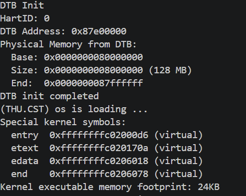

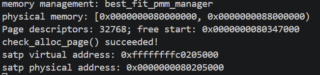

128 MiB对应32768个Page描述符，不等于全部页面空闲。默认构建空闲区从0x80347000开始，check_alloc_page成功。内核最后进入无限循环，退出模拟器使用Ctrl+A、松开后按X。

**2. 测试通过结果：make grade（仅此一项评分截图）**

```bash
make grade
```

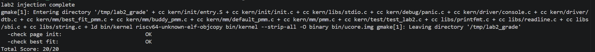

Page Init和Best-Fit两项均为OK，总分20/20。它仅反映评分器覆盖的两项，不包含Buddy或QEMU分支任务。

**3. First-Fit运行结果**

```bash
make clean
make PMM=first_fit qemu
```

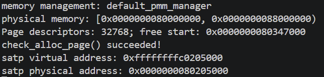

输出default_pmm_manager及自检成功；这张图不是两种算法选择空闲块的动态对照。

**4. Buddy实现与测试**

```bash
make clean
make PMM=buddy qemu
```

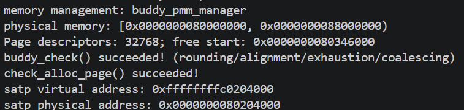

rounding/alignment/exhaustion/coalescing自检通过，测试覆盖说明见对应模块。Buddy构建的启动页表和空闲区地址可能与默认构建不同，不能混用两次运行的映像地址。

**5. 多内存配置补充测试**

```bash
python3 tools/verify.py
```

| 分配器 | 64 MiB | 128 MiB | 256 MiB |
|---|---|---|---|
| First-Fit | PASS | PASS | PASS |
| Buddy | PASS | PASS | PASS |
| Best-Fit | PASS | PASS | PASS |

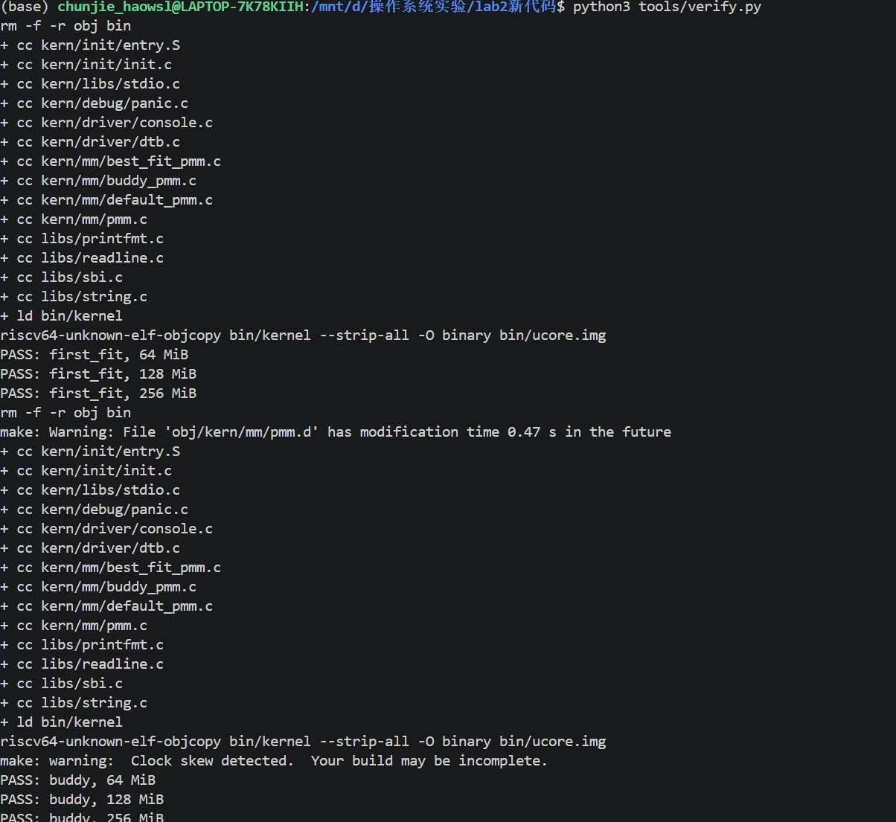

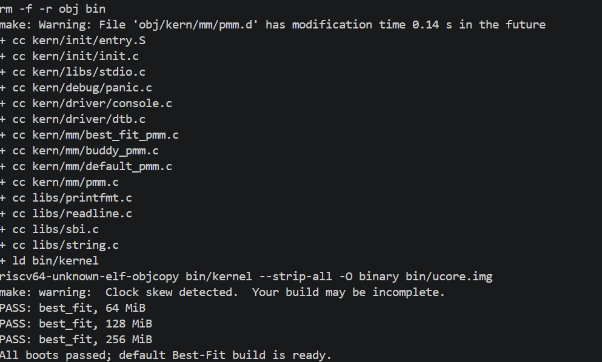

脚本每次切换先清理编译结果，以成功标志且无panic判断通过；超时用于退出内核的正常无限循环。截图中存在文件时间略晚于当前时间与Clock skew警告，九组输出均PASS，但不声称已消除警告。正式复验应核对Windows/WSL时间并清理重建，必要时在WSL原生文件系统复验。

**6. GDB内核调试**

终端A保持make debug，终端B运行make gdb：

```gdb
break kern_init
continue
break pmm_init
continue
backtrace
break best_fit_check
continue
p/x va_pa_offset
p npage
p nbase
p npage - nbase
p pages
p pages[0]
```

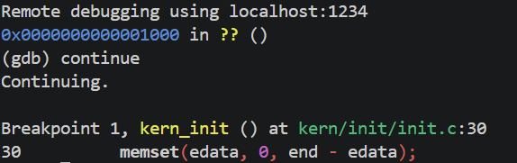

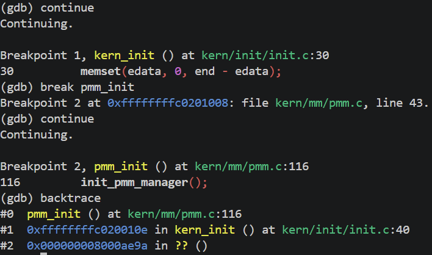

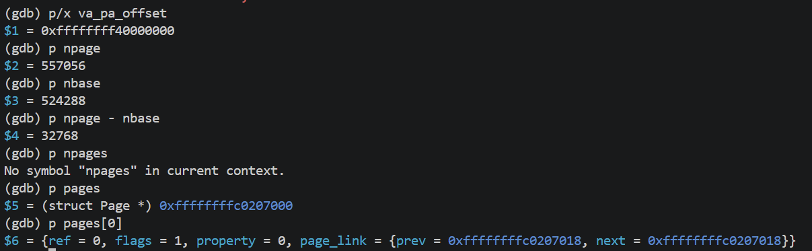

在best_fit_check停下时page_init已完成。npage=557056、nbase=524288，差为32768；pages=0xffffffffc0207000且按页对齐，pages[0].flags=1表示DRAM第一页保留。截图中一次p npages输错后已更正为p pages，不是内核bug。

**7. QEMU源码地址翻译与TLB调试记录**

```bash
python3 tools/capture_mmu.py
python3 tools/show_mmu.py walk
python3 tools/show_mmu.py tlb
```

第一条重新启动真实双GDB采集，后两条只展示已保存日志。运行前需要本机已构建的调试版QEMU及对应源码目录。

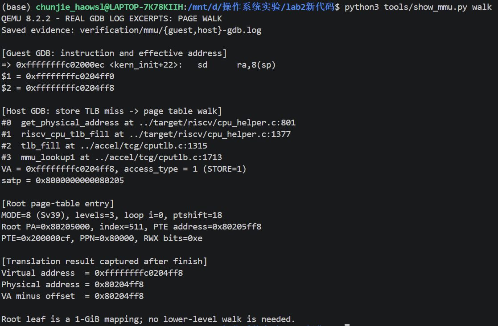

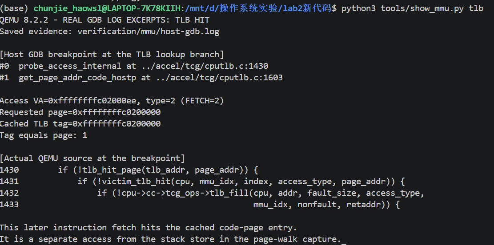

完整日志保存在verification/mmu/guest-gdb.log和host-gdb.log。第一页记录store的地址转换，第二页记录后续取指命中TLB；二者不是同一访问，也不将日志回放截图声称为实时交互界面。

**实验过程中的其他问题及处理：**

- 环境原缺RISC-V编译器、QEMU和多架构GDB；安装时修复了Python开发包依赖不一致。
- GDB连接超时后，先保持make debug运行再连接1234端口，成功命中断点。
- 输入mmake、xmakex或p npages均属于操作输入错误，按真实命令更正，不误判为算法问题。
- QEMU源码构建缺少distlib及部分固件安装文件时，补齐依赖并禁用blob安装，运行沿用系统已有固件。
- 修改PMM编译参数前需make clean，避免旧目标文件沿用旧管理器。

**验证范围：** 以上支持本实验单核、单段DRAM教学配置的功能验证，不构成任意硬件、所有非法调用或并发场景的正确性证明。SLUB未实现。


---

## 六、实验总结与收获

### 对操作系统的理解

**1. 本实验知识点与OS原理的联系、差异**

| 实验知识点 | 对应原理 | 联系与差异 |
|---|---|---|
| DTB内存范围与保留区域 | 物理内存发现、内存布局 | 原理讨论资源范围；实验依赖QEMU单段DRAM和简化DTB解析 |
| Page描述符与空闲链表 | 页框管理、元数据 | 物理页内容与管理描述符分离，描述符也占内存 |
| First-Fit、Best-Fit | 连续分配、外部碎片 | 选择策略不同；都可能因缺少连续块而在总空闲量足够时失败 |
| Buddy | 分级分配、内部碎片 | 二分和伙伴合并便于管理，但按2的幂取整会浪费部分块内空间 |
| Sv39及PTE | 多级页表和保护 | 9+9+9+12划分；8字节PTE；叶子可以提前出现在高层 |
| satp和sfence.vma | 地址空间上下文与转换同步 | 写页表基址后需要按体系结构要求同步，刷新缓存不等于删除页表 |
| TLB与QEMU软件缓存 | 地址转换缓存、局部性 | 命中减少查询开销；模拟器还要解决宿主地址定位 |
| GDB及条件断点 | 系统可观测性 | 打印“成功”仅是一类证据；调用栈、变量和真实PTE共同支持判断 |

**2. OS原理中重要但本实验未完整覆盖的知识点**

本实验没有实现完整用户进程地址空间、按需分页、缺页异常处理、页面置换、交换到磁盘、写时复制、用户内存共享、内存映射文件及多核TLB shootdown。当前启动大页映射也不等于完整建立所有4 KiB页的用户页表。分配器没有并发锁，不是可直接用于多核生产系统的实现。

### AI 协作开发的经验

本次AI协作主要用于环境配置、物理内存管理代码补全、测试设计和调试流程梳理。实际操作表明，描述需求时需要先说明目标文件、已有接口、允许修改的范围和验证标准。例如，实现page_init时明确npage与nbase的关系、描述符数组占用空间和页面对齐要求，能够减少地址类型混淆及空闲范围计算错误。

对于分配算法，仅要求“实现Best-Fit”或“实现Buddy”还不够，还需要明确分配成功与失败时的数据结构状态、块切分和合并条件、空闲页数变化以及释放接口的使用约定。将这些约束写清楚，有助于检查生成的代码是否与项目接口一致，也便于定位遗漏的分支。

实现与测试需要分别考虑。Buddy测试除了检查申请成功，还验证了请求取整、块对齐、内存耗尽、全量回收和伙伴合并。由此认识到，AI给出的“完成”说明不能代替真实编译和运行结果，测试通过也只能说明已覆盖场景符合预期，不能直接推断所有边界和并发情况都正确。

调试过程中，应先区分需要观察的对象。调试ucore内核时关注入口、调用栈和管理变量；调试QEMU源码时关注模拟器中的TLB查询与页表遍历。连接超时、命令输入错误、工具链依赖和启动参数问题也需要分别排查，不能都归因于算法错误。向AI提供完整错误输出、当前执行阶段和已尝试操作，比只描述“运行不了”更容易得到可验证的解决步骤。

本次还体会到，应把AI建议当作需要核实的方案：将地址翻译结果与实际页表项及偏移计算交叉检查，将管理器名称与实际算法选择对应起来，并保留原始日志。只有能够说明代码为什么这样运行、测试检查了什么及其局限，才能把生成的实现转化为自己能够复现和解释的实验成果。

---
